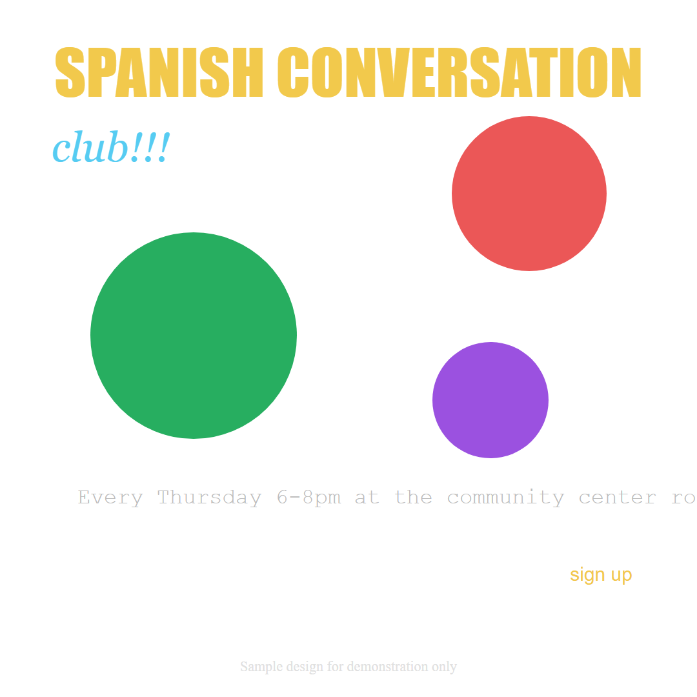
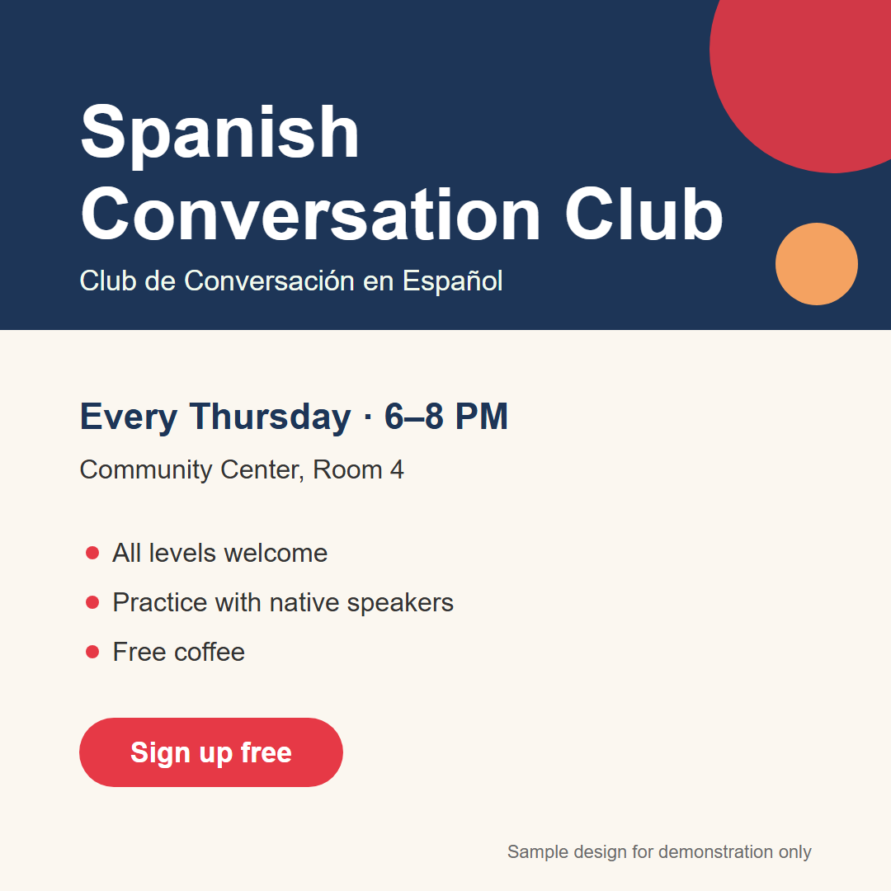

# Graphic Design Evaluation

A practical framework for **evaluating graphic designs**, both human-made and AI-generated: core design principles, a scoring rubric, and a worked before/after redesign with measured color contrast.

Useful for design-quality annotation tasks such as rating AI-generated images and layouts, comparing two designs side by side, and writing clear design feedback.

> The designs in this repo are **synthetic** and created for demonstration.

## Worked example

| Before | After |
|---|---|
|  |  |

Full side-by-side critique with scores and contrast measurements: [`examples/critique.md`](examples/critique.md)

## Contents

| File | Purpose |
|---|---|
| [`design-principles.md`](design-principles.md) | Hierarchy, alignment, contrast, spacing, typography, color and accessibility, with what to look for |
| [`design-review-rubric.md`](design-review-rubric.md) | 1–5 scoring rubric for designs, including AI-generation checks (text rendering, artifacts, prompt adherence) |
| [`examples/critique.md`](examples/critique.md) | Before/after critique with WCAG contrast ratios |
| [`examples/*.svg`](examples/) | Editable source files for both designs |

## How I review a design
1. **Five-second test:** what do I notice first, and is it the most important message?
2. **Check the information:** is every fact present, correct and readable?
3. **Check the structure:** hierarchy, alignment, spacing, grouping.
4. **Measure what can be measured:** color contrast, minimum text size, margins.
5. **Write specific feedback:** name the element, the problem, and the fix.

## License
MIT
