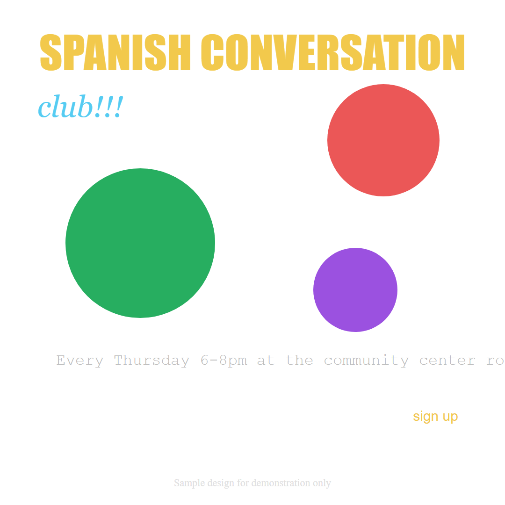
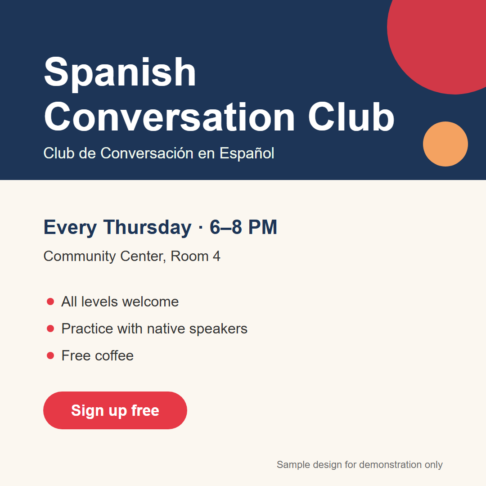

# Before / After Critique: Spanish Conversation Club Post (1080 × 1080)

*Both designs are synthetic. Same content, redesigned.*

| Before | After |
|---|---|
|  |  |

## Scores (rubric in [`../design-review-rubric.md`](../design-review-rubric.md))

| Dimension | Before | After |
|---|---|---|
| Message clarity | 2 | 5 |
| Hierarchy | 2 | 5 |
| Layout & alignment | 1 | 5 |
| Typography | 1 | 5 |
| Color & contrast | 1 | 4 |
| Completeness & accuracy | 2 | 5 |
| **Overall** | **1** | **5** |

Overall "before" is capped because the main text is below 3 : 1 contrast and key details run off the canvas.

## Contrast measurements (WCAG relative luminance)

| Text | Colors | Ratio | Result |
|---|---|---|---|
| Before: title | #F2C94C on #FFFFFF | 1.59 : 1 | Fails |
| Before: "club!!!" | #56CCF2 on #FFFFFF | 1.86 : 1 | Fails |
| Before: details | #BDBDBD on #FFFFFF | 1.88 : 1 | Fails |
| Before: "sign up" | #F2C94C on #FFFFFF | 1.59 : 1 | Fails |
| After: title | #FFFFFF on #1D3557 | 12.36 : 1 | Passes AAA |
| After: Spanish subtitle | #F1FAEE on #1D3557 | 11.56 : 1 | Passes AAA |
| After: date/time | #1D3557 on #FBF7F0 | 11.57 : 1 | Passes AAA |
| After: body text | #333333 on #FBF7F0 | 11.83 : 1 | Passes AAA |
| After: button label (34 px bold = large text) | #FFFFFF on #E63946 | 4.17 : 1 | Passes AA for large text |
| After: footer note | #6B6B6B on #FBF7F0 | 4.99 : 1 | Passes AA |

## Issues in "Before" and how "After" fixes them

| # | Element | Issue | Fix in "After" |
|---|---|---|---|
| 1 | Title | Light yellow on white (1.59 : 1); hard to read | White bold title on a dark navy band (12.36 : 1) |
| 2 | Fonts | Four families (Impact, Georgia italic, Courier, Times) with no clear roles | One family (Arial) in three clear sizes and two weights |
| 3 | Details | One long monospace line runs off the right edge; location is cut off | Details split into date (bold), place, and three bullets |
| 4 | Alignment | Centered title, left "club!!!", right-aligned "sign up" | One strong left margin at x = 96 for all text |
| 5 | Decoration | Three large unrelated circles dominate the canvas | Two small accent shapes kept in the header corner, clear of all text |
| 6 | Call to action | Small "sign up" text floating bottom-right | Filled pill button "Sign up free" after the details |
| 7 | Bilingual | No Spanish, though it's a Spanish club | Spanish subtitle "Club de Conversación en Español" |
| 8 | Tone | "club!!!" with three exclamation marks looks unprofessional | Clean title case, no extra punctuation |

## Remaining note on "After"
The white-on-red button label is 4.17 : 1. It passes AA only because the label is large bold text. A darker red (or a larger label) would make it pass for all text sizes.
